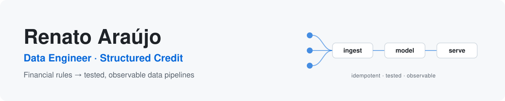

<picture>
  <source media="(prefers-color-scheme: dark)" srcset="assets/banner-dark.svg">
  
</picture>

  
  
  
  

I build data platforms for **structured credit**. Over 5+ years at a Brazilian securitization
firm that manages receivables investment funds (FIDCs), I moved from analyst to data engineer,
turning complex financial rules (present value, credit provisioning, reconciliation) into
modular, tested and observable pipelines on GCP.

### Recent impact (production)

| **6–8 h → ~30 s** | **10 days → 1 day** | **6 funds** |
|:---:|:---:|:---:|
| fund-portfolio generation, rebuilt on BigQuery/Dataform, Cloud Run and Cloud Workflows | to onboard a new fund, thanks to a configuration-driven design | in production on one codebase, with data-quality assertions and step-level tracking |

### Featured projects

| Project | What it shows |
|---|---|
| [**fidc-receivables-lakehouse**](https://github.com/tecozu/fidc-receivables-lakehouse) | Daily valuation of a receivables fund: idempotent file ingestion with a SHA-256 ledger, an event ledger, 252-business-day pricing, loss provisioning, incremental snapshots and a ledger-reconciliation test that caught a real bug. DuckDB + dbt + CI. |
| [**reconciliation-toolkit**](https://github.com/tecozu/reconciliation-toolkit) | Cash application (payments ↔ receivables), OFX/CSV bank statements with dedup and balance continuity, dataset comparison and file-health checks. |
| [**ecommerce-price-tracker**](https://github.com/tecozu/ecommerce-price-tracker) | Price history from Mercado Livre and the Shopee API. Separates real deals from fake discounts using trailing baselines and SCD2, and tests the classifier against ground truth. |
| [**weather-data-pipeline**](https://github.com/tecozu/weather-data-pipeline) | Airflow + dbt + Postgres + Superset in Docker. Hourly idempotent ingestion with a replayable JSONB payload; CI runs the real pipeline. |
| [**dropkit**](https://github.com/tecozu/dropkit) | Monitoring for the files partners send you: delivery SLAs on the B3 business-day calendar, SQL job alerts that fire once, Teams/Slack notifications, plus transfer, search, unzip and consolidation over local, S3 and SFTP. |
| [**csv-layout-validator**](https://github.com/tecozu/csv-layout-validator) | YAML data contracts for partner files: typed rules, CPF/CNPJ, cross-column checks, CI-friendly reports. |
| [**cnab-toolkit**](https://github.com/tecozu/cnab-toolkit) | Spec-driven generator, parser and validator for Brazilian fixed-width banking files, with layout linting and property-based tests. |

### Toolbox

**Cloud & warehouse**

**Transformation**

**Storage**

**Orchestration & infra**

**Quality & BI**

### Background

Certifications: Google *Build a Data Warehouse with BigQuery* · dbt Fundamentals · Databricks Fundamentals.
MBA in Business Management at FGV (in progress).
Languages: Portuguese (native), English (fluent), Spanish (intermediate).
